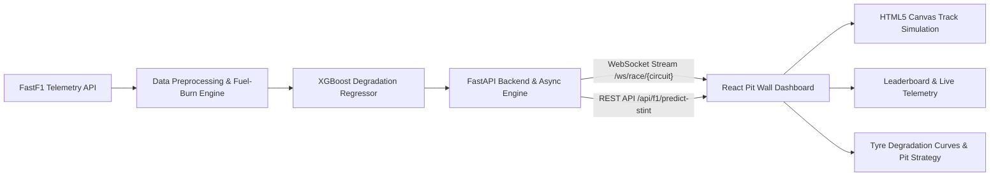

# 🏎️ Formula 1 Tyre Degradation ML Engine & Pit Wall Telemetry

[](https://fastapi.tiangolo.com)
[](https://www.python.org)
[](https://react.dev)
[](https://tailwindcss.com)
[](https://github.com/theOehrly/Fast-F1)
[](https://xgboost.readthedocs.io)

An end-to-end, real-time **Formula 1 Pit Wall Telemetry Dashboard** and **Tyre Degradation Machine Learning Engine** designed for the **2026 Season**. Built with FastAPI, WebSockets, HTML5 Canvas, React 19, and an XGBoost predictive model trained on high-frequency FastF1 telemetry data.

---

## 📌 Key Highlights

- **Machine Learning Tyre Degradation Model**: Predicts pace delta and lap times based on tyre compound (Soft, Medium, Hard), tyre life, track temperature, and fuel-burn corrections ($+0.038\text{ s/lap}$) ($R^2 = 0.829$, $\text{MAE} = 0.408\text{ s}$).
- **"The Cliff" Nonlinear Degradation Warning**: Detects the precise point where tyre performance drops sharply and delivers automatic pit stop window recommendations synchronized to exact race laps (`BOX LAP XX`).
- **Interactive HTML5 Pit Wall Canvas**: Renders authentic FastF1 GPS circuit coordinates with frame-accurate car motion, driver halos, DRS sectors, and telemetry readouts that stay synchronized with race laps across $0.5\times$, $1\times$, $2\times$, and $5\times$ speed multipliers.
- **Bi-directional WebSocket Streaming**: Real-time event broadcasting (`INIT`, `LAP_TICK`, `RACE_FINISHED`) with client controls for Play, Pause, Seek, Speed Selection, and Driver Focus.
- **Dynamic 2026 Circuit Selection**: Switch between official 2026 Grand Prix tracks (Silverstone, Bahrain, Jeddah, Melbourne, Spa, Monza, and more) with seamless telemetry loading and cached offline fallbacks.
- **Live Leaderboard & Stint Curves**: Click any of the 22 drivers to inspect their live stint health, compound delta, and interactive degradation curves powered by Recharts.

---

## 🏗️ Architecture & Data Flow



---

## 📁 Repository Structure

```text
tyre-degradation-ml-engine/
├── backend/
│   ├── app/
│   │   ├── main.py                  # FastAPI application entrypoint & CORS setup
│   │   ├── routers/
│   │   │   ├── f1.py                # REST routes (circuits, predictions, metadata)
│   │   │   └── stream.py            # WebSocket streaming & race control loop
│   │   └── services/
│   │       ├── f1_service.py        # FastF1 loader, GPS track extractor & fallback cache
│   │       └── ml_service.py        # XGBoost model loader & stint curve generator
│   ├── notebooks/
│   │   ├── model/
│   │   │   └── tyre_deg_model.joblib # Serialized XGBoost tyre degradation model
│   │   └── tyre_degradation_experiment.ipynb # Model training, fuel correction & evaluation
│   ├── requirements.txt             # Python backend dependencies
│   └── .env.example                 # Environment configuration template
├── frontend/
│   ├── public/                      # Static assets
│   ├── src/
│   │   ├── components/
│   │   │   ├── CircuitCanvas.jsx    # Canvas circuit rendering & synchronized car tracker
│   │   │   ├── Leaderboard.jsx      # Clickable 22-driver standing & tyre badges
│   │   │   ├── Navbar.jsx           # Circuit dropdown, playback controls & speed toggles
│   │   │   └── TyreAnalytics.jsx    # Recharts degradation curve, cliff marker & pit advice
│   │   ├── App.jsx                  # WebSocket client & primary Pit Wall layout
│   │   ├── index.css                # Tailwind CSS v4 styling & dark pit-wall theme
│   │   └── main.jsx                 # Vite application mount & react-grab integration
│   ├── package.json                 # Frontend dependencies (React 19, Lucide, Recharts)
│   └── vite.config.js               # Vite bundler configuration
├── .gitignore                       # Ignored caches, models, node_modules & environments
└── README.md                        # Documentation
```

---

## 🛠️ Tech Stack

### Backend
- **Framework**: [FastAPI](https://fastapi.tiangolo.com)
- **ASGI Server**: [Uvicorn](https://www.uvicorn.org) with async WebSocket protocol
- **Telemetry Ingestion**: [FastF1](https://github.com/theOehrly/Fast-F1)
- **Machine Learning**: [XGBoost](https://xgboost.readthedocs.io), [scikit-learn](https://scikit-learn.org), [Joblib](https://joblib.readthedocs.io)
- **Data Engineering**: [Pandas](https://pandas.pydata.org), [NumPy](https://numpy.org)

### Frontend
- **Framework**: [React 19](https://react.dev) + [Vite](https://vitejs.dev)
- **Styling**: [Tailwind CSS v4](https://tailwindcss.com) (Formula 1 Pit Wall high-contrast telemetry palette)
- **Visualizations**: HTML5 2D Canvas API & [Recharts](https://recharts.org)
- **Icons**: [Lucide React](https://lucide.dev)
- **Tooling**: [react-grab](https://github.com) for real-time component inspection

---

## 🚀 Getting Started

### 1. Prerequisites
- **Python**: `3.11` or `3.12` installed
- **Node.js**: `18.x` or `20.x` installed with `npm`

---

### 2. Backend Setup

1. **Navigate to the backend directory**:
   ```bash
   cd backend
   ```

2. **Create and activate a virtual environment**:
   - **Windows (PowerShell)**:
     ```powershell
     python -m venv venv
     .\venv\Scripts\Activate.ps1
     ```
   - **Linux / macOS**:
     ```bash
     python3 -m venv venv
     source venv/bin/activate
     ```

3. **Install dependencies**:
   ```bash
   pip install -r requirements.txt
   ```

4. **Configure environment variables** (optional for FastF1 account login):
   ```bash
   cp .env.example .env
   ```

5. **Start the FastAPI backend server**:
   ```bash
   uvicorn app.main:app --reload --port 8000
   ```
   The backend will be available at:
   - **API Docs (Swagger UI)**: [http://localhost:8000/docs](http://localhost:8000/docs)
   - **WebSocket Stream**: `ws://localhost:8000/ws/race/{circuit_name}`

---

### 3. Frontend Setup

1. **Navigate to the frontend directory**:
   ```bash
   cd frontend
   ```

2. **Install frontend dependencies**:
   ```bash
   npm install
   ```

3. **Start the Vite development server**:
   ```bash
   npm run dev
   ```
   Open your browser at [http://localhost:5173](http://localhost:5173).

---

## 🧠 Machine Learning Model & Strategy Physics

### 1. Fuel-Burn Correction
A standard Formula 1 car sheds approximately $100\text{–}110\text{ kg}$ of fuel across a race distance. As fuel burns off, the car naturally gains pace ($\approx -0.038\text{ s/lap}$). Without isolating this factor, pure lap times mask true tyre wear. 

The engine computes fuel-corrected pace:
$$\text{LapTime}_{\text{corrected}} = \text{LapTime}_{\text{actual}} + ((\text{TotalLaps} - \text{LapNumber}) \times 0.038)$$

### 2. Target & Features
The model trains an **XGBoost Regressor** on clean green-flag dry laps:
- `TyreLife`: Laps completed on the current tyre set.
- `Compound`: Categorically encoded compound (`SOFT`, `MEDIUM`, `HARD`).
- `TrackTemp`: Track surface temperature in degrees Celsius ($^\circ\text{C}$).
- `Driver`: Categorically encoded driver identifier.
- `Stint`: Stint index during the race.

### 3. Model Performance
- **$R^2$ Score**: `0.829` ($82.9\%$)
- **Mean Absolute Error (MAE)**: `0.408 seconds`
- **Output**: Multi-lap predicted pace curve up to 35 laps, identifying the transition from linear degradation to **"The Cliff"** ($\Delta \text{Pace} \ge 1.2\text{s}$).

---

## 📡 API & WebSocket Protocols

### REST Endpoints
| Method | Endpoint | Description |
|---|---|---|
| `GET` | `/api/f1/circuits` | Returns the list of 2026 season circuits with round numbers and venues |
| `GET` | `/api/f1/circuit/{name}` | Returns circuit metadata and normalized GPS track coordinates |
| `POST` | `/api/f1/predict-stint` | Generates a 35-lap degradation curve for a specific driver and compound |

### WebSocket Communication
Connect to: `ws://localhost:8000/ws/race/{circuit_name}`

**Inbound Messages (Client $\rightarrow$ Server):**
```json
{ "action": "PLAY" }
{ "action": "PAUSE" }
{ "action": "SET_SPEED", "speed": 2 }
{ "action": "SELECT_DRIVER", "driver": "16" }
{ "action": "SEEK", "lap": 25 }
```

**Outbound Messages (Server $\rightarrow$ Client):**
- `INIT`: Broadcasts circuit coordinates, driver metadata, and total laps.
- `LAP_TICK`: Broadcasts updated lap number, driver standings, telemetry speed, and ML predictions.
- `RACE_FINISHED`: Emitted upon checkered flag completion.

---

## 🎮 Pit Wall Controls & Navigation

- **Circuit Dropdown**: Switch between 2026 Grand Prix tracks in the top navigation bar.
- **Playback & Speed Multipliers**: Toggle `Play / Pause` and set playback rates (`0.5x`, `1x`, `2x`, `5x`). The vehicle graphics and lap counter remain in lockstep.
- **Driver Selection**: Click any row in the **Race Leaderboard** to track that specific car on the circuit with a highlighted halo and dynamically reload their tyre telemetry.
- **Compound Tabs**: Switch between `Soft`, `Medium`, and `Hard` in the Tyre Analytics card to simulate comparative stint lifespan and pit strategy windows.

---

## 📄 License & Disclaimer

This project is an open-source research and educational demonstration. **Formula 1**, **F1**, and related marks are trademarks of Formula One Licensing B.V. This project is not officially affiliated with, endorsed by, or sponsored by Formula One World Championship Limited. Telemetry data is parsed via the open-source [FastF1](https://github.com/theOehrly/Fast-F1) library.

